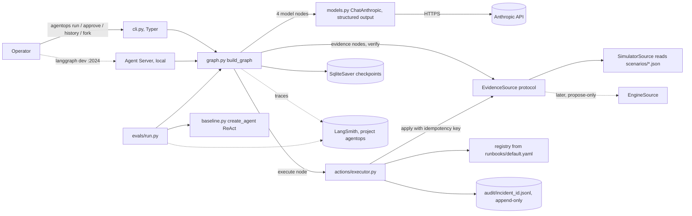

# AgentOps codebase map

Written 2026-09-30 at onboarding and updated by increment 1 (change
`2026-10-01-increment-1-scaffold`) and increment 3 (change
`2026-10-01-increment-3-act-pause-persist-resume`). "What exists today" is confirmed against the repository; the
sections after it describe the **planned** system from the approved design
(`docs/superpowers/specs/2026-09-29-agentops-design.md`, cited below as "design §n"), and any
planned path not in the table below is believed, not verified. Update this file in the change
that makes a statement here true or false.

## What exists today (confirmed 2026-10-01, increment 3)

| Path | What it is |
|---|---|
| `docs/superpowers/specs/2026-09-29-agentops-design.md` | The approved design, source of truth for stack, layout, commands and CI |
| `docs/superpowers/specs/2026-09-30-*.md` | Companions: eval methodology, cookbook, workshop, and the operator console (a **separate** repository, `muhibm1/agentops-console`) |
| `pyproject.toml`, `requirements.txt`, `requirements-dev.txt` | Package metadata and the `agentops` entry point; exact pins with licence comments |
| `LICENSE`, `README.md`, `CONTRIBUTING.md`, `docs/ci.md` | MIT licence, status and demo command, contributor setup, what CI checks |
| `src/agentops/cli.py`, `src/agentops/__main__.py` | Typer app: `--version`, `run`, `approve`, `resume`, `history` and `fork` over SQLite checkpoints (`--state-db`, default `agentops.sqlite`), thread id equal to the incident id; exit 0 for waiting, escalated or resolved, 1 usage, 2 run failed or state file unusable; the hidden `approve --crash-after-apply` is the crash demo; every model string escaped. `python -m agentops` runs the same app |
| `src/agentops/state.py` | `IncidentState`, the Pydantic models, `CONTROL_FIELDS`, `new_incident`, `CitationError`, `assert_cited` |
| `src/agentops/graph.py` | `build_graph`: `START -> triage -> router -> logs/metrics/deploys -> merge -> rca -> approval -> execute -> verify -> postmortem`, with escalate and the loops back to the router, retry policies and the checkpoint serializer |
| `src/agentops/nodes/` | `triage.py`, `router.py` (`route_to_sources`), `evidence.py` (parallel logs, metrics, deploys nodes), `merge.py` (budget, loops, `after_merge`), `rca.py`, `approval.py` (`interrupt()`, re-validated edits), `execute.py` (calls the executor), `verify.py` (re-reads the source, cleared or not), `postmortem.py`, `escalate.py`, shared helpers in `__init__.py` |
| `src/agentops/actions/` | `runbook.py` (loads and validates the runbook with `yaml.safe_load`), `registry.py` (`has`, `get`, `validate_params`), `preconditions.py` (six check kinds against the `EvidenceSource`), `audit.py` (append-only JSONL audit log), `executor.py` (registry, parameters, preconditions, idempotency key, ledger check, dry run, apply, audit) |
| `runbooks/default.yaml` | The action allowlist: `scale_db_pool`, `rollback_deploy`, `circuit_break_dependency`, `rerun_partition`, `pause_batch_job` |
| `src/agentops/sources/` | `EvidenceSource` protocol and value types (`base.py`), `Scenario` (`scenario.py`, combined worlds keyed `a+b`), `SimulatorSource` (`simulator.py`, applied actions kept in a ledger file) |
| `src/agentops/fakes.py` | `ScriptedChatModel` and `scripted_model_for`; in the package because the CLI demo uses it (ADR 0001) |
| `scenarios/*.json` | Eight scenarios with `scripted_outputs` (triage, rca, escalate for escalating ones, postmortem for the seven that apply an action, `rca_after_action` for `two_concurrent_faults`); `scripted_model_for` turns one into a model |
| `tests/` | pytest, one test per eval case; `conftest.py` clears LangSmith tracing variables |
| `.github/workflows/ci.yml`, `.github/dependabot.yml`, `.githooks/pre-push`, `scripts/check_test_count.py` | CI with SHA-pinned actions and a test-count floor, Dependabot, the pre-push hook |
| `.gitignore` | Tracked. Ignores `.env*` (except `.env.example`), `.venv/`, `*.egg-info/`, `*.db`, `*.sqlite`, `*.sqlite-*` (the SQLite WAL sidecars), `*.sqlite3`, `audit/`, caches and the WorkHorse working folders |
| `agentops.sqlite` and its `-wal`, `-shm` sidecars | Runtime, not tracked: the checkpoint file the CLI writes in the current directory |
| `audit/<incident_id>.jsonl`, `audit/<incident_id>.ledger.jsonl` | Runtime, not tracked: the append-only audit log (`proposal`, `approval`, `precondition`, `dry_run`, `apply`, `verify`, `escalation` records) and the simulator's ledger of applied actions |
| `.workhorse/profile.yml` | The WorkHorse profile; its commands are run on the change branch |

Not yet present: `langgraph.json`, `evals/`, `baseline.py`, `models.py`, the live model.

## What the system does

AgentOps is a LangGraph incident-response runtime. Given a service and its symptoms, it
investigates through evidence sources, proposes a remediation that cites its evidence, stops for a
human approval, executes only allowlisted actions idempotently, verifies, and writes a postmortem
or escalates. The rule behind every design choice: **the model recommends; the graph enforces the
boundary** (design §1). The model runs in four nodes (triage, rca, postmortem, escalate); every
edge, budget, approval and side effect is code.

## Planned architecture



### The request path, end to end (design §4, §7, §8)

1. `cli.py run --scenario <id>` builds the graph with a `SimulatorSource`, a `SqliteSaver` and a
   `thread_id`, and invokes it with the initial `IncidentState`.
2. `triage` (model) writes `hypotheses`. `router` (a conditional edge, deterministic) scores
   sources against open hypotheses and fans out with one `Send` per source.
3. `logs`, `metrics`, `deploys` call the `EvidenceSource` and append to `evidence` and `actions`
   through `operator.add` reducers, in one super-step. `merge` decrements `investigation_budget`
   and routes to `rca`, back to `router`, or to `escalate`.
4. `rca` (model) writes `root_cause` and `remediation`. The node rejects any citation of an
   evidence id that is not in state and lets `RetryPolicy(max_attempts=3)` retry.
5. `approval` calls `interrupt()` with the remediation, evidence, dry run and rollback. The run
   stops; the checkpoint is the durable boundary. The operator resumes with
   `Command(resume={"decision": ..., "reason": ..., "remediation": ...})`.
6. `execute` runs the executor: registry lookup, parameter schema, preconditions, idempotency key
   `sha256(incident_id + canonical(remediation))`, state and ledger check, dry run to audit log,
   apply, audit log, `execution`. `durability="sync"` around approval and execution.
7. `verify` re-reads the source; symptoms cleared goes to `postmortem` (model), otherwise back to
   `router` or to `escalate`. `recursion_limit=60` is a backstop, never an outcome.

### Boundaries

| Boundary | Direction | Trust |
|---|---|---|
| Anthropic API (`langchain-anthropic`, `anthropic`) | Outbound HTTPS from the four model nodes | Output is validated by Pydantic before entering state |
| LangSmith | Outbound traces when `LANGSMITH_TRACING=true` | Third party; receives prompts and synthetic evidence |
| `EvidenceSource` | Inbound evidence, outbound `apply` | Every payload is untrusted data (design §17); scenario 8 is a log injection |
| Scenario JSON files | Read at run time | Authored in-repo; carry ground truth that must never reach the model (`scenario_id` is hidden from it) |
| Runbook YAML | Read and validated at startup | The allowlist; a security boundary |
| SQLite checkpoint file | Local read and write | Holds full run state |
| Audit JSONL | Append-only write | The "who approved what, on what evidence" record |
| Operator (CLI, later console) | Inbound decisions | No authentication in v1 (design §18) |

## Patterns to follow (all planned, design §5 to §8; no example file exists yet)

| Concern | Pattern | Planned example path |
|---|---|---|
| Validation | Pydantic models for every model output, `with_structured_output(method="json_schema")`; control fields absent from output schemas | `src/agentops/state.py`, `src/agentops/models.py` |
| Errors | Validation failure raises inside the node and hits `RetryPolicy`; precondition failure returns structured evidence; out-of-registry action routes to `escalate` with a reason | `src/agentops/nodes/rca.py`, `src/agentops/actions/executor.py` |
| Auth | None in v1. The approval interrupt is the only human gate and cannot be disabled | `src/agentops/nodes/approval.py` |
| Logging | Append-only JSONL audit log per incident; `actions` in state records every tool call, retry, latency and token cost; LangSmith spans per node | `src/agentops/actions/audit.py` |
| Interfaces | `EvidenceSource` `Protocol` with two adapters; graph never knows which | `src/agentops/sources/base.py` |
| Tests | pytest; scripted fake chat model; `InMemorySaver` only in tests; fixtures in `tests/fixtures/` | `src/agentops/fakes.py` (ADR 0001) |

## Planned layout (design §13)

```
src/agentops/  state.py graph.py models.py baseline.py cli.py
               nodes/ (10 node modules)  sources/ base.py simulator.py  actions/ runbook.py registry.py executor.py audit.py
scenarios/     one JSON per scenario (8 in v1), templates/ in week two
runbooks/      default.yaml
evals/         dataset.py evaluators.py run.py checksums
tests/         pytest, fixtures/ (the fake model is src/agentops/fakes.py, ADR 0001)
docs/          discovery.md solution-design.md handover.md eval-methodology.md ci.md superpowers/specs/ sdlc/
examples/approval_boundary/   (week two, cookbook)
workshop/                      (after the cookbook)
langgraph.json pyproject.toml requirements.txt requirements-dev.txt
.github/workflows/ci.yml .github/dependabot.yml .githooks/pre-push
CLAUDE.md CONTRIBUTING.md LICENSE README.md
```

## Data inventory

No database tables. No personal, financial, health or special-category data by design (design
§17). Believed, not verified, until the code exists.

| Store | Contents | Personal data | Notes |
|---|---|---|---|
| `scenarios/*.json` | Synthetic signals, ground truth, grading key | None | The held-out subset is byte-pinned by `evals/checksums` |
| SQLite checkpoint file | Every `IncidentState` checkpoint per thread | One possible field: `Approval.operator` | If `operator` is an OS username or a real name it is a personal identifier of the operator. Recommend a role string; see open question Q4 in constraints.md |
| `audit/<incident_id>.jsonl` | Proposal, approval, preconditions, dry run, apply, verify | Same `operator` field | `.gitignore` covers `audit/` and `*.db` (confirmed 2026-10-01) |
| LangSmith traces | Prompts, model outputs, evidence | Same `operator` field if traced | Third-party processor; free tier retains base traces 14 days (design §12) |
| LangGraph `Store` (week two) | Postmortems by `("postmortems", service)` | None | `InMemoryStore` locally |

No storage buckets. No RLS, policies or database functions.

## Test layout (planned)

- `tests/` with pytest; the fake chat model in `src/agentops/fakes.py` returns each scenario's expected
  structured outputs so every transition, loop, budget, precondition, idempotency and injection
  case runs without an API key (design §11).
- CI asserts a test-count floor from the JUnit report and a test that parses the workflow and
  asserts SHA-pinned actions and no secrets in the default job (design §13).
- Live evals (`evals/run.py`) run only from a `workflow_dispatch` job reading `AGENTOPS_TEST_*`
  secrets and failing if any are missing.

## Planned CI (design §13)

One job without credentials, in order: install, `ruff check`, `pyright` (basic), `pytest` with a
test-count floor, `pip-audit` on runtime requirements (accepted advisories recorded in
`docs/ci.md`), build check (`langgraph build` dry validation, believed available; otherwise a JSON
schema check of `langgraph.json`). Actions pinned by 40-character SHA. Dependabot weekly for pip
and actions. `.githooks/pre-push` runs lint and tests.
