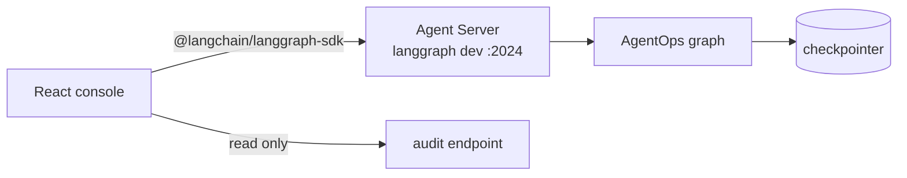

# AgentOps operator console

Status: draft for owner review, 2026-09-30. Companion to `2026-09-29-agentops-design.md`; builds
after AgentOps increment 4, when the graph runs under `langgraph dev`.

Versions confirmed against npm on 2026-09-30 unless marked "(believed)".

## 1. Why this exists

An approval gate is only as good as the screen the approver is looking at. In the CLI the operator
sees a remediation and types a decision; in a real deployment that person is an on-call engineer
at two in the morning who needs to see the evidence, the dry run and the rollback before saying
yes. The console is that screen, built on the LangGraph JavaScript SDK against the same Agent
Server API a customer would run in production.

It also closes the one gap in my GitHub that the LangChain posting names directly: TypeScript
on their stack. Every other project of mine that uses TypeScript is agent tooling.

## 2. What the operator can do

1. See every incident thread with its status, service, top hypothesis and time waiting.
2. Open an incident and watch it run live: each node as it starts and finishes, evidence as it
   arrives, hypotheses re-scored after each loop.
3. At the approval interrupt, read the remediation beside the evidence it cites, the dry-run
   description, the precondition results and the rollback plan, then approve, reject with a reason,
   or edit the parameters and submit. An invalid edit comes back with the graph's reason.
4. Browse the checkpoint history as a timeline and fork from any checkpoint by changing a
   hypothesis score, then watch both branches side by side.
5. Read the audit log for an incident as a table.

Nothing else. The console never calls the model and never applies an action; every decision goes
back to the graph through `Command(resume=...)`, so the boundary the design document describes is
the same boundary in the browser.

## 3. Architecture

- `Client` from `@langchain/langgraph-sdk` for threads, runs, state and history.
- Live runs through the SDK's streaming API with `streamMode` values for updates and custom
  events; the React bindings in `@langchain/langgraph-sdk/react` (`useStream`, believed to be the
  current hook name) where they fit, the plain client where they do not.
- Resume is a new run on the same thread with a `command: { resume: {...} }` payload, the HTTP
  equivalent of the Python `Command(resume=...)` (believed; confirmed at scaffold time against
  the SDK docs before any code depends on it).
- Fork uses the thread state update endpoint with a `checkpoint_id` and `as_node`, mirroring
  `update_state` in Python.
- The audit log is served by a tiny read-only route added to AgentOps's `langgraph.json` HTTP app
  (believed supported through the custom routes option; otherwise the console reads the audit
  records the graph also writes into state).

The console holds no state of its own beyond what is on screen. Refreshing the page loses nothing,
because the thread is the truth.

## 4. Repository and stack

Repository `muhibm1/agentops-console`, MIT. A separate repository so the Python project stays
single-language and the console reads as the deliverable it is.

| Package | Version | Licence |
|---|---|---|
| `@langchain/langgraph-sdk` | 1.12.0 | MIT |
| `react`, `react-dom` | 19.3.0 | MIT |
| `vite` | 8.3.1 | MIT |
| `typescript` | 7.0.2 | Apache-2.0 |
| `vitest`, `@testing-library/react`, `oxlint`, `tailwindcss` | pinned at scaffold | MIT |

Node 24 in `.nvmrc`, `engines` at `>=22.12`, `.npmrc` with `engine-strict=true` created by the
owner by hand (the harness refuses to write `.npmrc`), every dependency an exact pin, Actions
pinned by SHA. Same CI order as Portfolio: pin check, `npm ci`, typecheck, lint, test with a count
floor, build, `npm audit --omit=dev` blocking.

## 5. Testing

- Component tests with vitest and Testing Library against a fake SDK client that replays recorded
  stream events from fixture files. The fixtures are captured once from a real `langgraph dev` run
  of scenarios 2, 6 and 8, so the tests exercise real event shapes without a server.
- One end-to-end test (Playwright, dispatch-only in CI) that starts `langgraph dev` with the fake
  model, opens scenario 1, approves, and asserts the incident resolves.
- The approval panel gets the most tests: every resume payload shape, the invalid-edit path, and
  that approve is disabled until the evidence panel has loaded.

## 6. Design

Dense and calm, for someone tired: a two-column incident view, evidence on the left, the
decision on the right, the timeline across the top. Status colour carries meaning only (waiting,
running, resolved, escalated). One typeface. No charts in v1 beyond the metric sparklines the
scenarios already contain. Keyboard shortcuts for approve and reject behind a confirmation.

## 7. Security

The console talks only to the Agent Server URL in its config. Evidence payloads are rendered as
text, never as HTML, because they are untrusted log content and scenario 8 contains an injection.
No authentication in v1, stated plainly in the README; `langgraph dev` is local. A deployed version
would sit behind the Agent Server's auth handler, documented as the next step, not built.

## 8. Increments

| # | Increment | Demoable at the end |
|---|---|---|
| 1 | Scaffold, CI, SDK client, incident list, live run view from recorded fixtures | A run streams on screen |
| 2 | Approval panel with approve, reject, edit; audit table; end-to-end test | The crash-resume demo driven from the browser |
| 3 | History timeline, fork, side-by-side branches; README with a short screen recording | The red-herring fork story in the UI |

## 9. Non-goals

Multi-user operation, authentication, notifications, mobile layout beyond readable, editing
runbooks, starting incidents from arbitrary input (v1 starts them from scenario ids).

## 10. Decisions

| # | Decision | Alternative | Why |
|---|---|---|---|
| 1 | Separate repository | A `console/` folder in AgentOps | Single-language repositories, independent CI, and it reads as its own deliverable |
| 2 | Agent Server API through the official SDK | A custom FastAPI layer | The SDK and Agent Server are what a LangChain customer deploys; a custom API would prove less |
| 3 | Recorded stream fixtures in tests | A live server in every test | Fast, deterministic, no secrets, and still real event shapes |
| 4 | Evidence rendered as text only | Markdown rendering | Logs are untrusted input |
